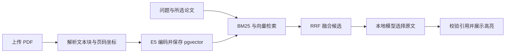

# 两个项目：使用流程、核心代码与简历表述

这份指南对应已经实际完成的 TraceLab 接口测试平台和 PaperTrail 论文阅读助手。先照步骤演示一遍，再按代码阅读路线理解实现，最后使用简历文案。

## 一、先把网页打开

两个应用部署在同一台服务器，但目录、数据库和端口独立。

| 项目 | 服务器目录 | 网页端口 |
|---|---|---|
| TraceLab 接口测试平台 | `/home/xf/practice/tracelab` | 18090 |
| PaperTrail 论文阅读助手 | `/home/xf/practice/paper-reader` | 18100 |

**第一步：在 VS Code 已连接服务器的终端中检查并启动应用。** 以下命令在服务器执行，不能直接粘贴到本机 Windows PowerShell。

```bash
cd /home/xf/practice/tracelab
.venv/bin/python scripts/server.py status
.venv/bin/python scripts/server.py start

cd /home/xf/practice/paper-reader
.venv/bin/python scripts/server.py status
.venv/bin/python scripts/server.py start
```

start 会识别已经运行的项目进程。服务器重启后需要手动启动，目前没有配置开机自启。

**第二步：转发端口。** 在 VS Code 的“端口”面板添加 18090 和 18100，然后点击对应的本地地址。也可以在本机 Windows 终端中执行下面一条 SSH 命令，密码在终端提示时输入：

```powershell
ssh -N -L 18090:127.0.0.1:18090 -L 18100:127.0.0.1:18100 xf@192.168.9.100
```

这条命令没有输出、一直停在那里通常是正常的，它在维持转发，不是卡住。不要关闭这个终端。已经转发过的端口不必重复添加；若提示端口被占用，先检查是否已有转发。

**第三步：在电脑浏览器打开。**

- 接口测试平台：<http://127.0.0.1:18090>
- 论文阅读助手：<http://127.0.0.1:18100>

这里的 127.0.0.1 指你的电脑，SSH 会把请求转给服务器。过去的 8000 地址是本地开发版，不是现在这套服务器平台。

## 二、TraceLab 如何使用

### 1. 跑一次正常回归

1. 打开平台，在下拉框选择“正常订单服务”。
2. 点击“运行回归测试”。
3. 查看任务历史，任务会从 queued 变为 running，最后显示 passed、failed 或 error。
4. 点击任务，展开右侧各个场景。
5. 默认套件有 10 个业务场景，正常版本的已验证预期是 **10/10 通过**。
6. 展开“下单、查询、取消与库存恢复”，按顺序查看注册、登录、创建商品、下单、查询、取消及库存断言。

页面显示的请求、响应、耗时和日志是实际执行所得。每个场景使用新的随机用户/商品数据，不依赖上一次执行留下的订单。

### 2. 演示平台如何发现问题

1. 切换到“缺陷演示：关闭库存校验”。
2. 点击运行。缺陷服务是独立实例，不是通过前端伪造一个红色结果。
3. 已验证预期是 **9/10 通过，1 个失败**。
4. 展开“库存不足应拒绝且库存不变”。前面的商品创建响应显示 stock=0。
5. 找到下单请求：数量为 1，预期 HTTP 409，实际 HTTP 201。
6. 查看该步的 trace_id，再查看同一 trace 的业务日志：`stock_guard_enabled=false`、`inventory_updated=true`。
7. 原因候选指向库存校验被关闭；它引用日志证据，不改变失败判定。

当前失败步骤会终止该场景，所以后续“库存不变”断言没有继续执行。不要向面试官描述成该场景内的全部断言都执行过。

### 3. 修改一个自己的用例

展开“编辑并保存 JSON 用例”，先在默认套件上修改。用例内的关键字段：

| 字段 | 含义 |
|---|---|
| method / path | 请求方法与相对路径 |
| headers / body | 请求头和 JSON 请求体 |
| status | 明确预期的 HTTP 状态码 |
| assertions | 响应 JSON 字段与预期值的相等断言 |
| extract | 从响应中提取值，供后续步骤引用 |

例如登录成功后用 `"extract": {"token": "access_token"}` 保存 token，后续请求头使用 `"Authorization": "Bearer {{token}}"`。`{{nonce}}` 是每个场景独立生成的随机值。

初次练习建议：在默认套件中找到数量为 0、预期 422 的场景，把数量改成 -2，保存，再对正常服务运行。它仍应被参数校验拒绝。进一步把预期 422 故意改成 201，就能看到“错误的测试预期”也会造成失败：失败不一定说明服务实现有问题。

点击“保存并用于下次运行”后，新任务会使用该套件；点击“恢复默认套件”回到原来的 10 个场景。刷新页面后前端选择会重置为默认套件，已保存套件仍在数据库中。

### 4. 导入接口文档

“导入 OpenAPI 3.x JSON”接收 JSON 文件，展示路径、参数、请求体、响应和鉴权定义。它目前是**接口目录解析**，不是自动生成完整业务用例，也不是持久化接口管理系统。

要取得订单服务的文档，可额外转发服务器端口 18091，访问 `http://127.0.0.1:18091/openapi.json`，保存为 JSON 后导入。接口调试页面是同端口的 `/docs`。

### 5. 运行代码级测试与报告

在服务器对应目录执行：

```bash
cd /home/xf/practice/tracelab
.venv/bin/python scripts/server.py test
.venv/bin/python scripts/server.py demo
```

test 使用专门测试数据库，验证接口、权限、并发库存等；demo 通过真实 HTTP 向运行中的平台提交正常/缺陷两次任务。

**16 项自动化测试与页面 10 个回归场景不是同一个计数。** 前者包含平台自身和并发测试，后者是预置业务套件。已有测试报告在项目 `reports/` 中。

## 三、TraceLab 的核心代码

建议按这个顺序阅读：`app/cases.py` → `app/platform.py` → `app/worker.py` → `app/pytest_runner.py` → `app/executor.py` → `app/shop.py` → `app/db.py` → `app/analysis.py`。


### 核心 1：用配置描述测试，而不是给每个接口写一套执行代码

`cases.py` 定义场景和参数结构；`executor.py` 统一执行步骤。登录 token、商品 ID、订单 ID 保存在一个场景的 context 中，由 `extract` 写入、`render()` 读取。

场景间使用不同 nonce，避免同时运行时共用账号或商品。场景内顺序传递数据，形成一条完整业务链。

### 核心 2：后台任务执行与结果持久化

`platform.py::enqueue()` 返回 HTTP 202，只负责保存任务，不在网页请求里等待整套测试完成。它将套件内容复制到 Run，因此之后修改套件不会改变旧任务的测试内容。

`worker.py::process_one()` 把 queued 条件更新为 running，然后启动固定 pytest 模块。用户配置是 JSON，不是任意可执行代码。结果写入 Result，状态、数量和退出码汇总到 Run。

只有一个 Worker 的重启恢复策略已实现：遗留 running 被标为 interrupted，要求重新提交。没有实现分布式调度、租约、心跳、多 Worker 崩溃恢复。正常业务断言失败是 failed；网络、模板或执行器异常是 error。默认不自动重试。

### 核心 3：并发库存与幂等是数据库问题

`shop.py::create_order()` 的库存扣减相当于：

```sql
UPDATE products
SET stock = stock - :quantity
WHERE id = :product_id AND stock >= :quantity;
```

判断库存与扣减由一条 SQL 完成；修改行数为 0 表示条件不满足。库存更新与写订单在同一事务中，一起提交、一起回滚。

`db.py::Order` 对 `(user_id, idem_key)` 设置唯一约束。同一幂等键同参数返回原订单；同键不同参数返回冲突。两次请求即使同时通过应用层查询，也不能绕过数据库唯一约束。发生冲突时，回滚还会撤销本次重复扣减的库存。

取消订单也使用条件更新：只有首次将 created 改为 cancelled 的请求才恢复库存，重复取消不重复加库存。

### 核心 4：可定位的失败证据

订单服务为每次请求生成 trace_id，把它同时放入响应头和服务日志。执行器使用这个 ID 获取对应日志，保存请求、响应、明确断言和业务事件。

`analysis.py` 给出原因候选，但不能改变通过/失败结论。当前已验证的是规则分析；模型接口存在，但项目 1 尚无真实模型调用验收。不能把日志引用存在等同于根因已被证明。

## 四、PaperTrail 如何使用

### 1. 导入并选择论文

1. 打开助手，点击左侧“导入论文 PDF”。
2. 选择文本型、未加密的 PDF，限制 25 MB、80 页。不支持纯扫描件 OCR。
3. 等待解析完成；新文档会进入论文库并自动选中。同一内容再次上传会去重。
4. 检索前勾选需要阅读的论文，最多 8 篇。网页刷新后需要重新勾选。

论文原文件保留在服务器，问答也会保存到历史。当前没有删除按钮、多用户账户、配额或自动清理功能。

### 2. 做一次带引用的问答

1. 先只选择《Attention Is All You Need》。
2. 选择“混合检索”，保持“模型选择证据”勾选。
3. 输入“论文使用了哪些数据集？”，或点击“数据集”示例按钮后点击“查找证据”。
4. 查看结果来源：本地模型选证、检索原文摘录，或无匹配证据。
5. 点击引用按钮“第 7 页”，右侧显示论文原页和文本块高亮。
6. 点击“打开完整 PDF”，核对上下文。这里是 PDF 文件页码，不一定等于论文印刷页码。

中文问题可以检索英文论文，但当前答案保留原文摘录，不是自动翻译。回答里有英文本身是预期行为。

### 3. 观察无证据和模型降级

只选合成论文 Cedar，输入“火星地震震级具体数值是多少？”。这是已验证的无关问题，应显示未找到证据。这个状态表示当前检索/选证未找到支持，不是严格证明论文绝对没写过。

取消勾选“模型选择证据”，再次问数据集问题，就能直接观察检索摘录。模型超时、JSON 格式错误或伪造引用时也会退回摘录，并显示不同来源。模型明确返回空引用时显示未找到证据。

### 4. 多论文对照

1. 选中 Cedar、Maple 两篇合成论文，取消其他论文。
2. 点击“生成证据对照表”。
3. 查看数据集、指标、方法、局限四行，每篇论文一列。
4. 点击各格中的页码核对来源。

这些材料和实验数值都是虚构的，只用于测试。对照表是证据整理，不会把不同数据集、不同指标的数值直接判定为“谁更好”。

### 5. 检索轨迹与评测

问答下方“查看检索轨迹与评分”显示候选块、页码和分数。分数用于排序，不是正确概率。左侧“评测报告”读取最近一次实际运行结果，并不会点击后自动重跑评测。

要重跑，在服务器执行：

```bash
cd /home/xf/practice/paper-reader
.venv/bin/python scripts/server.py test
.venv/bin/python scripts/server.py evaluate
```

已验证 16 项自动化测试；合成集有 8 道有答案问题、2 道无关问题。三种检索方式在该小型集合上通过，不能写成真实论文问答准确率 100%。另有一篇真实论文的两个中英文问题样例，仍不是大规模真实评测集。

## 五、PaperTrail 的核心代码

阅读顺序：`paper/api.py` 的 upload → `paper/parse_worker.py` → `paper/parser.py` → `paper/retrieval.py` → `paper/answers.py` → `paper/api.py` 的 page_image → `scripts/evaluate.py`。



### 核心 1：引用可靠性从解析阶段开始

`parser.py` 保存每个块的正文、章节、文件页码、bbox 和顺序编号。bbox 是原页坐标矩形，不是屏幕像素。双栏按左右栏顺序处理，跨栏块用于分段；这仍是启发式，并不能完美解析所有版式。

长文本块最多切成 1200 字符，步长 1000，保留 200 字符重叠。不跨页切分，避免一个块无法确定出处页。切片继承原始块的坐标，所以高亮可能比引用句子更大。

`api.py::upload()` 使用 SHA-256 去重，通过独立子进程解析 PDF，设置超时；解析子进程在 Linux 上还限制 CPU 时间和内存。随后保存原文件、文档信息及文本块向量。

### 核心 2：关键词和语义检索互补

`retrieval.py` 的 BM25 根据词频、词稀有程度、段落长度计算相关性。它对具体名词、数据集名称和数字更直接；索引内容包括章节标题，避免“局限”只出现在标题时漏掉正文。

E5 将问题和文本转为 384 维向量；问题前缀是 `query:`，文本前缀是 `passage:`。ONNX 输出 token 向量后，排除 padding 做平均池化，再 L2 归一化。服务器使用 CPU 推理，向量存在 pgvector。

pgvector 目前做限定论文集合的精确余弦排序，没有部署 HNSW/IVFFlat 近似检索索引。没有实际验证的高并发或百万文档能力，不应写进简历。

### 核心 3：RRF 融合的是名次

BM25 和余弦得分的尺度不同，不能直接把原始分数相加。代码用 RRF，将一个文本块在每条检索路线上的贡献记为 `1 / (60 + 排名)`，累加后排序。

hybrid 使用两条路线；keyword 只按关键词排序且不加载嵌入模型；vector 按向量排序。候选还经过相关性门槛和正文长度过滤，避免短标题占据答案。语义阈值是经验值，仍可能漏召回或误召回。

### 核心 4：让模型选证，并由后端校验

`answers.py` 只把检索候选发给本地 Qwen，要求返回 chunk_id 和逐字 quote。`validate_selection()` 检查 ID 属于当前候选，quote 是相应文本的真实子串。

论文 ID、章节和页码由服务器从命中块取得，不信任模型自报的页码。`page_image()` 再检查文本块、论文、页码一致，才能在原页画框。

这个设计降低伪造引用风险，但**原文确实存在，不代表它充分回答了问题**。本项目实现的是可核对的证据式回答，不应描述成“彻底消除幻觉”。

### 核心 5：评测指标必须说清分母

| 指标 | 实际检查什么 | 不能代表什么 |
|---|---|---|
| recall_at_5 | 8 道有答案问题的标注页码及片段是否进入前 5 候选 | 完整答案是否正确 |
| abstention_accuracy | 2 道无关问题是否返回无证据 | 所有未知问题都能拒答 |
| citation_location_check_rate | 有引用的问答中，引用是否匹配候选文本、论文与页码 | 推理或语义蕴含正确率 |
| duration_ms | 本次执行耗时 | P95、压力测试性能 |

## 六、可放入简历的描述

以下只采用已实现且有证据支撑的表述。项目是 AI 辅助开发；请先亲自跑通、理解并按你的实际贡献调整，不把生成的代码直接表述为未经辅助的独立成果。项目日期按你的实际投入时间填写。

### 项目 1：接口自动化测试与失败定位平台（TraceLab）

**技术栈：Python、FastAPI、pytest、HTTPX、SQLAlchemy、PostgreSQL**

**项目概述：** 面向订单接口回归测试，构建集用例配置、后台执行、结果持久化及失败证据追踪于一体的测试平台。

- 实现 JSON 场景配置、跨接口参数提取与传递及独立 Worker 执行，支持 OpenAPI 接口目录解析、测试任务快照和结果持久化。
- 围绕订单、库存与权限设计 10 个业务回归场景，通过数据库事务、条件更新和幂等唯一约束处理重复提交、并发扣库存及重复取消，完成 16 项自动化测试。
- 关联请求响应、trace ID 与服务端业务日志，提供可追溯的失败原因候选；通过独立缺陷实例复现并检出“库存不足仍下单成功”的问题。

**面试口述版：** “我做的是一个订单接口回归平台。测试用 JSON 描述，Worker 用 pytest 和 HTTPX 顺序执行，登录 token 和订单 ID 可以跨步骤传递。我重点处理了并发库存和幂等请求，并用 trace ID 把失败请求和服务日志关联起来。演示时切到缺陷实例，同一套回归会发现库存为零仍然下单成功，能够直接追到对应日志。”

当前不建议写：“已部署 Docker”“已接入并通过线上 CI”“已验证大模型自动根因分析”“分布式调度平台”“提升定位效率 XX%”。相关配置或接口存在，不等于已经验证这些成果。

### 项目 2：带证据引用的论文阅读助手（PaperTrail）

**技术栈：Python、FastAPI、PyMuPDF、PostgreSQL、pgvector、ONNX Runtime、E5、Ollama/Qwen**

**项目概述：** 面向文本型论文 PDF，实现中英文检索、原文证据问答与跨论文对照，并通过页码和文本块坐标支持引用核对。

- 实现 PDF 文本块解析与页码、章节、坐标映射，支持双栏启发式排序、页内重叠切分、上传去重及引用原页高亮。
- 结合 BM25 与多语言 E5 向量检索，使用 pgvector 余弦排序和 RRF 融合候选；接入本地 Qwen 选择原文证据，并校验引用 ID、原文片段和来源。
- 实现数据集、指标、方法与局限的跨论文证据对照，构建 10 道合成问题及真实论文验证样例，完成 16 项自动化测试，覆盖缺证据、跨论文引用错误和模型失败降级。

**面试口述版：** “我做的是一个可以回到原文核对的论文助手。解析时保留文本、页码和坐标，提问后同时走关键词和语义检索，再把候选交给本地模型选择证据。模型只能返回原文片段，后端校验引用是否真实存在，点击页码能看高亮。我还把检索命中和引用定位分别评测，避免只看回答是否流畅。”

当前不建议写：“答案准确率 100%”“消除幻觉”“支持扫描件 OCR”“支持任意复杂表格精确解析”“海量文档低延迟服务”。

## 七、你至少要能回答的六个问题

1. 为什么并发库存不能只先 SELECT 再 UPDATE？——检查与修改之间可能被其他请求插入；条件原子更新将两者合并。
2. 唯一约束冲突为什么要回滚库存？——本次请求可能已经扣过库存，必须保证扣减和订单写入一起撤销。
3. 测试失败为什么不一律自动重试？——重试可能掩盖不稳定缺陷，还可能引入重复业务副作用。
4. 为什么要保存 bbox，而不只有页码？——页码定位到页，bbox 才能定位具体文本块并高亮。
5. 为什么 BM25 和向量结果用 RRF？——原始分数尺度不同，融合排名更容易比较。
6. 引用存在能保证回答正确吗？——不能，只证明文字和位置真实存在，相关性与论证充分性还需要评估。

建议先各自录一次五分钟演示，再亲手新增一个测试场景、为一篇你常读的论文标注五个问题。这样简历上的技术点会有自己能解释的实际经历。
